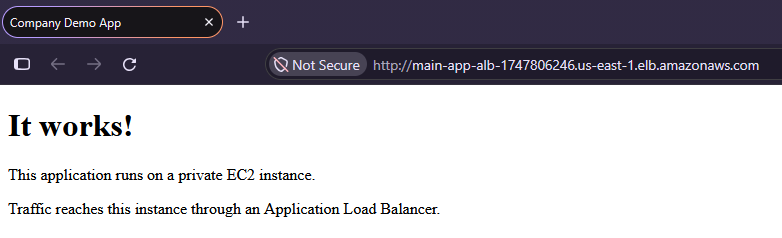
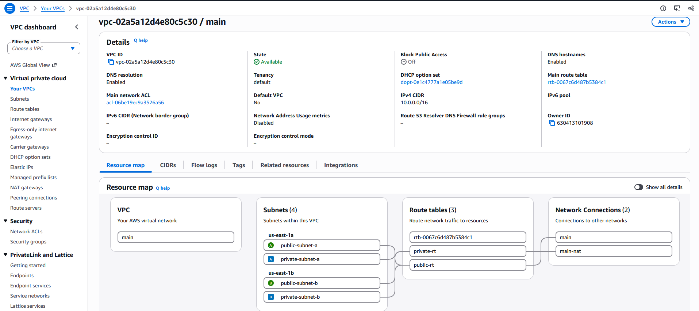
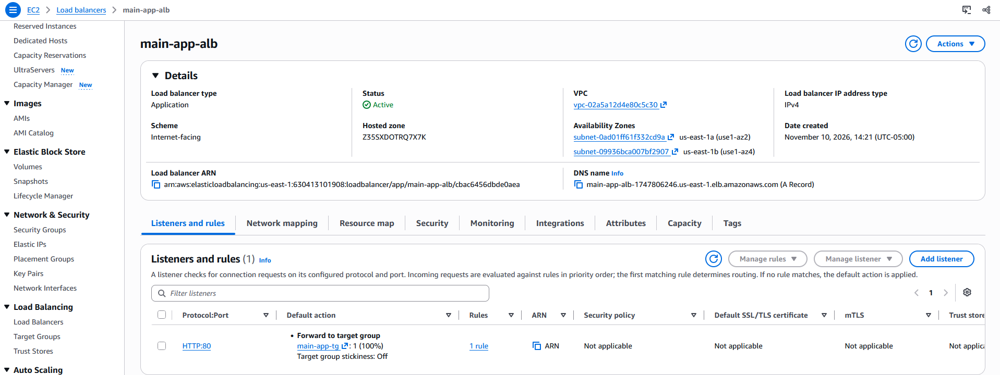
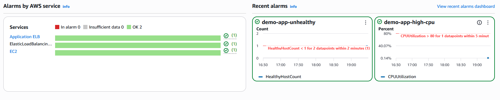
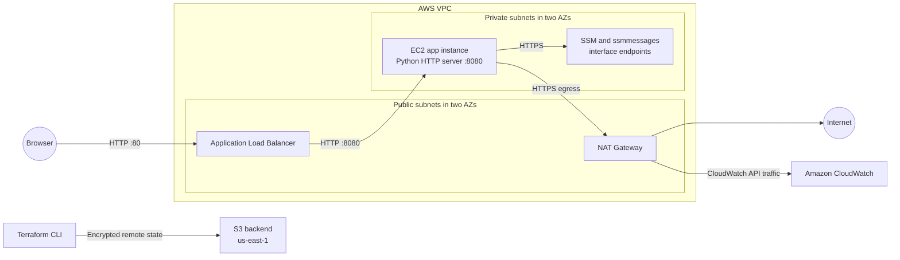
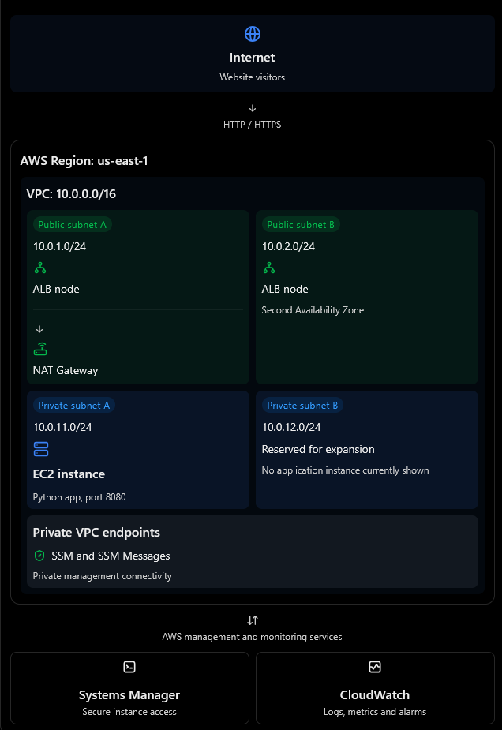

# AWS Environment with Terraform

[](https://developer.hashicorp.com/terraform)
[](https://aws.amazon.com/)

**A Terraform-managed AWS environment for a small web application, with a public load balancer and a privately hosted EC2 instance.**

> Learn by building: provision the network, deploy a private web server, and add practical access and monitoring components.

## Project overview

I built this project to practice provisioning and connecting core AWS infrastructure with Terraform. It creates a two-Availability-Zone VPC layout, routes HTTP requests through an Application Load Balancer (ALB) to a private Amazon Linux EC2 instance, and configures Systems Manager access and CloudWatch monitoring.

The demo app is a static page served by Python's built-in HTTP server. The project is intended as a learning example and a starting point for experimenting with infrastructure as code; it is not a production-ready, highly available application.

## Project demo



*The ALB routes browser traffic to the demo web server running on the private EC2 instance.*

## Key features

- **Segmented VPC networking:** Creates public and private subnets in two available Availability Zones, with internet and NAT gateways and separate route tables. The subnets provide a clear example of separating public entry points from application compute.

  

  *The VPC resource map shows the four subnets and their route-table associations.*

- **Load-balanced HTTP entry point:** An internet-facing ALB listens on port 80 and forwards traffic to an instance target group on port 8080, with an HTTP health check.

  

  *The ALB is internet-facing and forwards HTTP requests to the application target group.*

- **Private EC2 application host:** Launches an Amazon Linux 2023 instance in a private subnet without a public IP. Security-group rules allow application traffic from the ALB rather than directly from the internet.
- **Systems Manager access:** Attaches the `AmazonSSMManagedInstanceCore` policy and configures SSM and `ssmmessages` interface endpoints, so the instance can be managed without opening SSH ingress.
- **CloudWatch logs and alarms:** Ships application, system, and cloud-init logs; collects memory and disk metrics with the CloudWatch agent; and defines alarms for high EC2 CPU and a low healthy-target count.
- **Terraform-managed state and outputs:** Configures an encrypted S3 backend and exposes the application URL, VPC details, and private instance ID as outputs.

### CloudWatch logs


*CloudWatch log groups receive the configured application, system, and cloud-init logs.*

### CloudWatch alarms



*The configured high-CPU and unhealthy-target alarms are visible in CloudWatch.*

## Technologies and tools

| Category | Technology | Use in this project |
| --- | --- | --- |
| Infrastructure as code | Terraform (>= 1.10) | Declares AWS resources, inputs, outputs, and the S3 state backend. |
| Cloud provider | AWS, via HashiCorp AWS provider `~> 6.0` | Hosts networking, compute, load balancing, Systems Manager, and monitoring resources. The lock file currently pins provider 6.69.1. |
| Instance operating system | Amazon Linux 2023 | Runs on the EC2 app instance; its AMI is resolved from the AWS public SSM parameter store. |
| Instance bootstrap | Bash, `dnf`, and systemd | Installs Python and the CloudWatch agent, writes the demo page and service, and starts the agents at boot. |
| Demo web server | Python 3 `http.server` | Serves the static HTML page on port 8080. |
| Management | AWS Systems Manager Session Manager | Provides a management path to the private instance through its IAM role and VPC endpoints. |
| Observability | Amazon CloudWatch and CloudWatch agent | Receives configured log files and memory/disk metrics; evaluates EC2 CPU and ALB target-health alarms. |
| Version control | Git | Tracks incremental project development; `.terraform.lock.hcl` records the selected provider version. |

There is no application package manager, database, test framework, or CI workflow in the repository.

## Architecture and project structure

The ALB is public, while the app instance is private. Inbound app traffic is limited to the ALB security group. The private subnet's default route uses a single NAT gateway for outbound internet access (for example, instance package installation); SSM management traffic can use the configured interface endpoints.



The ALB spans two public subnets, and the private subnets span two Availability Zones. **The application itself is a single EC2 instance in private subnet A**, and both private subnets use one NAT gateway in public subnet A. These are learning-project choices, not multi-instance or per-AZ high-availability configurations.

The diagram is illustrative: the configuration creates interface endpoints for Systems Manager, but does not create a CloudWatch VPC endpoint. Instance CloudWatch traffic therefore uses outbound HTTPS through the NAT gateway.



*The deployment's main network paths and AWS components at a glance.*

### Repository layout

```text
.
├── backend.tf          # S3 remote state backend
├── compute.tf          # IAM role, security groups, ALB, target group, EC2 instance
├── main.tf             # VPC
├── monitor.tf          # CloudWatch log groups, agent policy, metric alarms
├── networking.tf       # Subnets, routes, gateways, and VPC endpoints
├── outputs.tf          # Application URL, VPC details, and instance ID
├── provider.tf         # AWS provider configuration
├── userdata.sh         # Instance bootstrap, demo app, and CloudWatch agent config
├── variables.tf        # Configurable input variables
├── versions.tf         # Terraform and provider version constraints
├── .gitignore          # Excludes local state, plans, and variable files
├── .terraform.lock.hcl # Locked provider version and checksums
└── screenshots/        # Demo, AWS console, Session Manager, and architecture images
    ├── alarms.png
    ├── alb.png
    ├── architecture-diagram.png
    ├── log groups.png
    ├── main-dashboard.png
    ├── session manager.png
    └── vpc.png
```

### Component responsibilities and request flow

1. Terraform provisions the VPC, subnets, gateways, routes, security groups, and VPC endpoints.
2. The ALB accepts HTTP on port 80 and forwards requests to the EC2 target on port 8080.
3. EC2 user data installs Python and the CloudWatch agent, creates a static HTML page, and configures a systemd service to run Python's HTTP server.
4. The instance can reach Systems Manager through its IAM role and the SSM endpoints. CloudWatch receives the configured logs and metrics.
5. Terraform prints the ALB URL and instance ID as outputs for testing and Session Manager access.

## Getting started

### Prerequisites

- Terraform 1.10 or later.
- An AWS account and credentials available through the AWS provider's standard credential chain (for example, an AWS CLI profile or environment credentials).
- AWS permissions to create and manage the resources declared in this project.
- An existing S3 bucket named `aws-environment-terraform` in `us-east-1`. The bucket is configured in [`backend.tf`](backend.tf) and must exist before `terraform init`; this project does not create it.

The backend bucket and state key are fixed in the configuration, and the backend region is `us-east-1`. The AWS provider region is separately configurable. Terraform commands that access the backend or AWS resources require suitable credentials.

### Clone and configure

```sh
git clone https://github.com/machratwit/AWS-environment-with-Terraform.git
cd AWS-environment-with-Terraform
```

Optionally create a local `terraform.tfvars` file to set the AWS region and restrict public HTTP access. The file is ignored by Git:

```hcl
aws_region       = "us-east-1"
allowed_http_cidr = "203.0.113.10/32" # Replace with your public IPv4 address
```

`allowed_http_cidr` defaults to `0.0.0.0/0`, which allows HTTP from any IPv4 address. Restrict it to the intended client CIDR before deployment. Other declared variables include `vpc_cidr`, `instance_type`, and `log_retention_days`; subnet CIDRs and the backend settings are currently defined in the Terraform configuration.

No application dependencies need to be installed locally. Terraform installs the AWS provider during initialization.

### Format, validate, and deploy

```sh
terraform init
terraform fmt -check
terraform validate
terraform plan
terraform apply
```

Review the plan before applying. This configuration creates billable resources, including an ALB, NAT gateway, Elastic IP, interface endpoints, EC2 instance, and CloudWatch resources. AWS charges may continue until the resources are destroyed.

### Tests

There is no automated test suite in the repository. `terraform fmt -check` and `terraform validate` provide formatting and configuration checks; `terraform plan` previews the proposed AWS changes.

## Usage examples

### Open the demo application

After a successful apply, print the load balancer URL:

```sh
terraform output -raw application_url
```

Open the resulting HTTP URL in a browser. The page is served by Python on the private instance and reached through the ALB.

### Connect to the private EC2 instance

With AWS CLI v2 and the Session Manager plugin available, retrieve the instance ID and start a session. In PowerShell:

```powershell
$instanceId = terraform output -raw private_instance_id
aws ssm start-session --target $instanceId --region us-east-1
```

If you changed `aws_region`, use that region in the CLI command. The instance has no public IP and the security groups do not allow inbound SSH.


*Session Manager provides a way to connect to the private instance without SSH ingress.*

### Inspect monitoring data

The configured CloudWatch log groups are:

- `/demo-app/application`
- `/demo-app/system`
- `/demo-app/cloud-init`

The configuration also creates `demo-app-high-cpu` (average EC2 CPU greater than 80% over a five-minute period) and `demo-app-unhealthy` (fewer than one healthy ALB target for two one-minute evaluation periods). No alarm notification actions are configured.

### Tear down

When finished, remove the resources managed by this Terraform configuration:

```sh
terraform destroy
```

The separately provisioned S3 backend bucket and its state object are not removed by `terraform destroy`.

## Technical challenges and problem-solving

These are implementation challenges reflected in the code and project history; personal motivation and the difficulty of each task cannot be determined from the repository alone.

| Challenge | Approach in the implementation | Result and trade-off |
| --- | --- | --- |
| Keeping the web server off the public internet while still making it reachable | Place EC2 in a private subnet with no public IP; accept public HTTP at the ALB and allow port 8080 from the ALB security group only. | Separates the public entry point from the application host. The public listener is HTTP, not HTTPS. |
| Managing a private instance without SSH ingress | Attach the Systems Manager core policy to the instance role and create SSM and `ssmmessages` interface endpoints. | Enables a Session Manager access path without opening inbound SSH. |
| Bootstrapping and operating the instance consistently | Use EC2 user data to install packages, create a systemd service, configure log collection, and start the CloudWatch agent. | The demo app and monitoring configuration are reproducible at instance creation; startup depends on successful package installation. |
| Making operational behavior observable | Configure log groups with retention, CloudWatch agent collection for memory and disk, and CPU/target-health alarms. | Provides basic signals for logs and health. Alarm actions/notifications are not configured. |
| Growing the infrastructure iteratively | Commit history shows the work progressing from backend and VPC setup to networking, compute, ALB, VPC endpoints, monitoring, and variables. | The resulting configuration separates those concerns into Terraform files; the history does not document the personal reasons behind each decision. |

**Personal context to add:** [What initially motivated this project, and which implementation problem took the most iteration?]

## Skills demonstrated

- **Infrastructure as code:** Terraform resources, provider/version constraints, variables, outputs, data sources, and remote state.
- **AWS networking:** VPC CIDR planning, public/private subnets, Availability Zones, route tables, internet/NAT gateways, and interface endpoints.
- **Cloud security fundamentals:** security-group references, private compute, IAM instance roles, encrypted root storage, and required IMDSv2 tokens.
- **Compute provisioning:** Amazon Linux AMI selection through SSM Parameter Store, EC2 user data, Bash, package installation, and systemd service configuration.
- **Traffic routing:** ALB listener, target group, health checks, and instance attachment.
- **Observability:** CloudWatch log groups, agent configuration, metric collection, retention, and alarms.
- **Version control and incremental delivery:** Git history records infrastructure additions in stages, including networking, compute, load balancing, endpoints, monitoring, and configuration variables.

This repository does not demonstrate a separate application framework, database design, frontend UI work, automated application tests, or CI/CD pipeline.

## What I learned

The implementation provides concrete practice with Terraform-based AWS provisioning, subnet routing, security-group-based traffic boundaries, private instance management, EC2 bootstrapping, and basic CloudWatch monitoring. The commit history also shows the infrastructure being developed and refined in stages rather than introduced as one large configuration.

Personal takeaways cannot be verified from code. Add your own reflection before presenting this as a first-person learning statement:

- **New tools or concepts I learned:** [Add your experience.]
- **Most important debugging lesson:** [Describe a specific issue and how you resolved it.]
- **What I would approach differently next time:** [Add your reflection.]

## Future improvements

The following are proposed enhancements; they are not currently implemented:

- Add HTTPS with an ACM certificate and a domain name; redirect HTTP to HTTPS.
- Add automated checks in CI, such as Terraform formatting, validation, and plan review.
- Add Terraform tests or policy checks, plus a repeatable deployment smoke test for the ALB health check and demo page.
- Improve availability by running multiple application instances across private subnets (for example, with an Auto Scaling group) and revisiting the single-NAT-gateway design.
- Review default network access and provide safer deployment defaults for the ALB's public HTTP CIDR.
- Consider VPC endpoints for additional AWS services if reducing NAT dependency is a goal.
- Make the S3 backend bucket configurable or document its secure creation, versioning, and access controls.

## Setup and contribution

There is no `CONTRIBUTING.md` or established contribution workflow in this repository. To discuss an improvement, open a [GitHub issue](https://github.com/machratwit/AWS-environment-with-Terraform/issues); pull requests can include a concise description and the Terraform checks run. Avoid committing state files, saved plans, or local variable files.

## License

No `LICENSE` file is present, so the project's license is **not specified in this repository**. Do not assume that the code is available for reuse under an open-source license.

## Acknowledgments

- [Terraform documentation](https://developer.hashicorp.com/terraform)
- [HashiCorp AWS provider documentation](https://registry.terraform.io/providers/hashicorp/aws/latest/docs)
- [AWS Systems Manager documentation](https://docs.aws.amazon.com/systems-manager/)
- [Amazon CloudWatch documentation](https://docs.aws.amazon.com/cloudwatch/)
